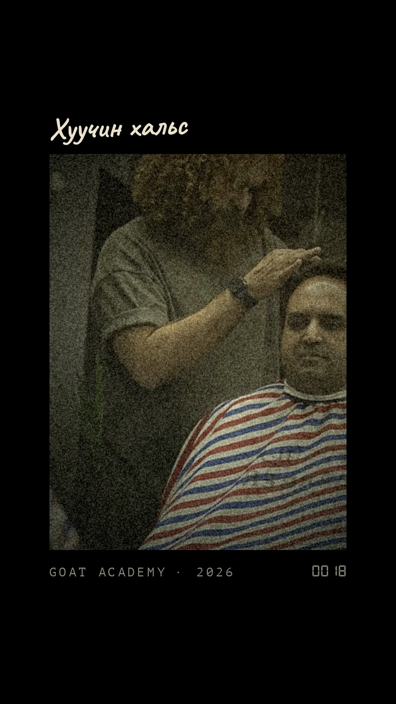

# 🐐 Super 8 Home Movie · Хуучин хальс

<p align="center"></p>

**Claude Code дотор ажилладаг видео эдитийн skill.** Бичлэгийг 1970-аад оны гэр бүлийн хальсан кино шиг болгоно: дулаан, бүдэг өнгө, ширхэгтэй дүрс, 18 кадраар чичирсэн хөдөлгөөн, хар дэвсгэр дээрх жижиг босоо хүрээ.

Reels, TikTok-д бэлэн 1080×1920 MP4 гаргана. GOAT Academy-гийн 14 эдитийн стилийн нэг.

---

## Юунд тохирох вэ?

- **Тохирно:** сүйт бүсгүйн үс, будалт, салоны "бидний түүх", гэр бүлийн бизнес, коучийн түүх
- **Тохирохгүй:** хумсны өнгө, үсний будгийн өнгө харуулах (дулаан өнгө жинхэнэ өнгийг өөрчилнө), онлайн бараа, үл хөдлөх, машин

---

## Шаардлага

- **Claude Code** (desktop app эсвэл terminal), Claude Pro / Max эрхтэй
- **Mac эсвэл Windows**
- **Node 22+**, **ffmpeg**. Байхгүй бол Claude өөрөө шалгаад, суулгах командыг хэлж өгнө.
- **Компьютер:** Mac эсвэл 64-bit Windows 10/11. Apple чиптэй Mac (M1+) дээр туршсан. Windows дээр одоогоор туршаагүй.
- Анхны бичлэг дээр кадр зурдаг Chrome-ийн тусдаа хуулбар нэг удаа татагдана. Бүх зүйл таны компьютер дээр ажиллана, юу ч интернэтэд илгээгдэхгүй.

---

## Суулгах

**Хамгийн хялбар:** Claude Code-оо нээгээд энэ мөрийг хуулж бичнэ:
```
Энэ plugin-ийг суулгаад өг: https://github.com/SaagiiSG/goat-super8
```
Claude өөрөө суулгана. Дараа нь `/reload-plugins` гэж бичих эсвэл Claude Code-оо хаагаад дахин нээнэ.

**Эсвэл өөрөө:** Claude Code дотор энэ 2 мөрийг ээлжлэн бичнэ:
```
/plugin marketplace add SaagiiSG/goat-super8
/plugin install goat-super8@goat-super8
```

**Zip файлаар авсан бол:**
1. `goat-super8.zip`-ийг задална. Задалсан `goat-super8` хавтсаа устгалгүй үлдээгээрэй.
2. Claude Code-д "Энэ хавтсан дахь plugin-ийг суулгаад өг:" гэж бичээд задалсан `goat-super8` хавтсаа чирж оруулна.
3. `/reload-plugins` гэж бичнэ.

**Шинэ хувилбар гарвал:** Claude-д "goat-super8 plugin-ийг шинэчил" гэж хэлэхэд болно.

> **For Claude Code:** to install this plugin, run `claude plugin marketplace add SaagiiSG/goat-super8` (or, from an unzipped copy, `claude plugin marketplace add <path to the goat-super8 folder>`) and then `claude plugin install goat-super8@goat-super8`, then tell the user to type `/reload-plugins`. To update it: `claude plugin marketplace update goat-super8` and then `claude plugin update goat-super8@goat-super8`.

---

## Хэрэглэх

1. Видео бүрд **шинэ хоосон хавтас** үүсгэ.
2. Claude Code-ийг тэр хавтсанд нээ.
3. Бичнэ: `/goat-super8:goat-super8` эсвэл энгийнээр: **"энэ бичлэгийг хуучин хальсан кино шиг болгоод өг"**
4. Бичлэгээ чирж оруулаад хүрээний дээр гарах гар бичмэл шиг 2–3 үгээ бичнэ.
5. Claude юу хийхээ товч хэлнэ. Таалагдвал "ок" гэхэд л болно.
6. `output/super8.mp4` бэлэн. Instagram, TikTok руу шууд оруулна.

---

## Дуу

- **Дуу эффект** автоматаар орно. Кодоор хийсэн учир лицензийн асуудалгүй. Хэрэггүй бол "дуу эффектгүй болго" гэж хэлэхэд болно.
- **Өөрийн дуугаар ярих (voice-over):** утсаараа дуугаа бичээд (voice memo) өгнө. Таны дуу гарах үед бичлэгийн дуу, хөгжим өөрөө намсна.
- **Хөгжим:** Instagram, TikTok апп дотроос нэмбэл зохиогчийн эрхийн асуудалгүй.

---

## Бичлэг хийх зөвлөгөө

- Гар дээрээ барьж, хүмүүс хөдөлж байгаа мөчүүдийг ав.
- Байгалийн гэрэл хамгийн сайн.
- Олон богино бичлэг (1–2 секунд) авбал илүү амьд харагдана.

---

Фонтууд нь Google Fonts-оос (OFL лиценз). Лицензийн файлууд `fonts/` хавтсанд байгаа.
